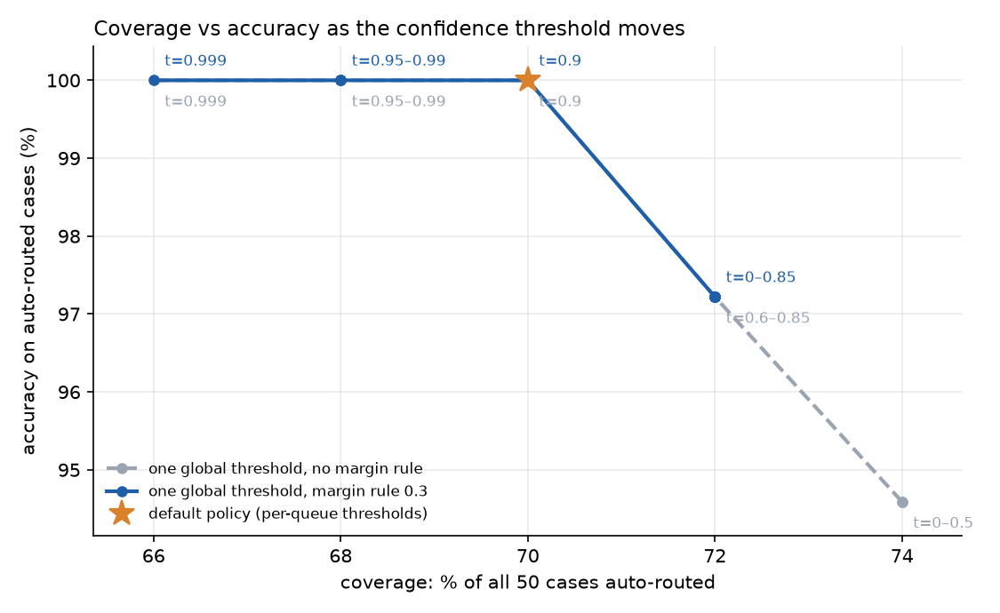
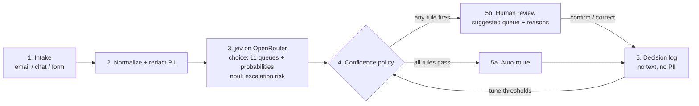

# jev-support-routing

Route customer-support messages to the right queue with **jev**, TypeSafe's decision model (served through OpenRouter's Decisions API), and send anything uncertain or high-risk to a person.

jev answers a *choice question* ("which of these 11 queues?") with a calibrated probability for every option, and a *yes/no question* ("is this a legal threat, chargeback or injury?") with a probability. A small, fully tested policy turns those numbers into **auto-route** or **human review**, with the reason recorded.

> All 50 tickets in `data/cases.jsonl` are **EXAMPLE data**: hand-written, with made-up names, order numbers, emails and card numbers.

## Results (live run, Nov 9, 2026, `typesafe/jev-1.14`)

| | |
|---|---|
| Auto-routed | **35 / 50 (70%)**, accuracy **100%** (0 wrong) |
| Sent to human review | **15 / 50 (30%)**: 8 high-risk queue, 4 off-topic/greeting/cut-off, 2 escalation flag, 2 below threshold, 1 low margin (some had more than one reason) |
| Tickets that should reach a person | 15 / 15 did |
| Clear tickets auto-routed | 35 / 35 |
| Top-1 queue accuracy, all 50 | 94% (the 3 misses were multi-intent or ambiguous tickets, all sent to review) |
| Latency p50 / p95 | 0.15 s / 0.20 s per ticket (both questions in one call) |
| Cost | $0.0016 for all 50 (about $0.03 per 1,000 tickets) |

Full report with every ticket, confusion summary and threshold sweep: [`results/live-2026-11-09/report.md`](results/live-2026-11-09/report.md).



**Reading the sweep:** with a single global threshold of 0.85 or lower, one multi-intent ticket ("cancel my subscription and refund the last three months", p = 0.86) is auto-routed to cancellations; at 0.9 or higher, or with the default per-queue thresholds (cancellations needs 0.90), it goes to a person and auto-routed accuracy is 100% at 70% coverage. Without the margin rule, a second one (p = 0.54) slips through at thresholds below 0.6. The hard rules cap coverage at 74%, because 13 of the 50 tickets are fraud, legal, off-topic or escalations by design. jev's probabilities also moved by up to 0.04 between two live runs on identical input (that ticket was 0.82 in the first run), so leave a buffer rather than setting a threshold right at an observed value. Fifty tickets is a demo, not a benchmark: tune on your own labeled volume (see [tuning](docs/ARCHITECTURE.md#tuning-the-coverage-versus-accuracy-trade-off)).

## Architecture



**Confidence policy** (`config/policy.json`): a ticket is auto-routed only if none of these fire.

| rule | default |
|---|---|
| `always_human` | top queue is `fraud_security` or `legal_privacy` |
| `high_risk_shadow` | a high-risk queue has p ≥ 0.20 even if not on top |
| `no_auto_route` | top queue is `other` (greeting, cut off, off-topic) |
| `escalation_risk` | yes/no escalation probability ≥ 0.50 |
| `below_threshold` | top p below the queue's threshold: billing and cancellations 0.90, account changes 0.85, default 0.80, shipping 0.75, product questions 0.70 |
| `low_margin` | top-1 minus top-2 < 0.30 (two intents compete) |
| `model_error` | API error or no probabilities: fail closed to a person |

Why each threshold is where it is, and how to tune it, is in [docs/ARCHITECTURE.md](docs/ARCHITECTURE.md).

**Queues** (`config/queues.json`, plain-language criteria sent with each request): `billing_refunds`, `order_shipping`, `returns_exchanges`, `tech_login`, `account_changes`, `fraud_security`, `product_questions`, `complaints_escalation`, `cancellations`, `legal_privacy`, `other`.

## Quickstart

Python 3.10+, no dependencies (matplotlib optional, for the chart).

```bash
# Offline: replays the recorded jev responses in recordings/. No key, no network.
python3 -m jevroute run
python3 -m jevroute review          # the human-review queue, high-risk first
python3 -m jevroute tune --target 0.95   # suggested per-queue thresholds from the decision log
python3 -m unittest discover -s tests -t .

# Live: calls jev on OpenRouter.
export OPENROUTER_API_KEY=...        # or put it in .env (git-ignored) and `set -a; . ./.env; set +a`
python3 -m jevroute run --mode live
python3 -m jevroute run --mode live --record   # refresh recordings/ after changing queues or prompts
python3 -m jevroute classify "I was charged twice for order #A123" --subject "double charge"
```

Replay mode warns when a recording was made with a different request (queue text or policy model changed), so recorded results can't silently drift from the code.

## How human review works
1. A ticket that trips any rule lands in the review queue with the model's suggested queue, the runner-up, the top probability and the reasons (`always_human`, `low_margin`, ...).
2. High-risk tickets are shown first. The reviewer confirms the suggestion (one click; it was right for 80% of reviewed tickets in the live run) or picks another queue.
3. The confirmed queue becomes the `label` on that ticket's decision-log row. `jevroute tune` uses those labels to suggest the lowest per-queue threshold that still meets your accuracy target, so coverage grows as evidence accumulates and shrinks for any queue that starts making mistakes.

## Repo layout
```
config/queues.json        queue names and plain-language criteria (sent to jev)
config/policy.json        model id, thresholds, margin, always-human and no-auto-route queues
data/cases.jsonl          50 EXAMPLE tickets: expected queue, whether a person should see it, and a note
jevroute/redact.py        normalization + PII redaction
jevroute/client.py        live OpenRouter client and offline replay client
jevroute/pipeline.py      intake -> redact -> jev -> policy -> decision-log row
jevroute/policy.py        the confidence policy and threshold tuning (pure functions)
jevroute/report.py        metrics, sweep, chart, markdown report
recordings/               recorded jev responses (redacted request + response; no headers, no key)
results/live-2026-11-09/  live-run report, metrics.json, decisions.jsonl, sweep.png
scripts/check_secrets.py  secret scanner used by the pre-commit hook and CI
tests/                    policy, redaction and offline end-to-end tests (no network)
```

## Security: the API key is never exposed
- The key is read only from the `OPENROUTER_API_KEY` environment variable, at call time, and only goes into the `Authorization` header of the request to OpenRouter. It is never printed, logged, recorded or written to disk.
- `.env` is git-ignored; [`.env.example`](.env.example) has a placeholder.
- Recordings and decision logs hold redacted text or no text at all, and never headers. A test asserts that no recording contains `Authorization`, `Bearer` or `sk-or-`.
- Secret scanning: enable the pre-commit hook once per clone with `git config core.hooksPath .githooks`. It runs `scripts/check_secrets.py --staged`, which fails on OpenRouter and other `sk-` key patterns, bearer tokens, real-looking `OPENROUTER_API_KEY=` lines, and the exact key value if it is set in your environment, without ever printing the match. CI runs the same script plus gitleaks over the full history on every push.
- Customer PII is redacted before the model call (emails, phones, Luhn-valid card numbers, SSNs, IPs). Names and street addresses are not detected by the regex redactor; add an NER step before using real tickets.
