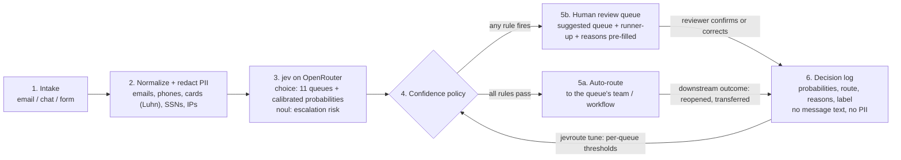

# Architecture

Every support message goes through the same six stages. Only stage 3 calls a model; the rest is plain code that can be read, tested and audited.



## 1. Intake
A ticket arrives with a channel, a subject and a message (`data/cases.jsonl` holds 50 EXAMPLE tickets). In production this is a webhook from the help desk.

## 2. Normalization and PII redaction (`jevroute/redact.py`)
- Unicode NFKC, control characters removed, whitespace collapsed, length capped at 4,000 characters.
- Emails, phone numbers, payment card numbers (only when the Luhn check passes, so order and tracking numbers survive), SSN-shaped numbers and IPv4 addresses become `[EMAIL]`, `[PHONE]`, `[CARD]`, `[SSN]`, `[IP]`.
- Only the redacted text is sent to the model, written to recordings, or used anywhere later. The log stores the *count* of each redaction, never the value.
- Limitation: names and street addresses are not detected by regex. A production deployment should add an NER-based redactor here; the interface (`redact(text) -> (text, counts)`) stays the same.

## 3. Classification with jev (`jevroute/pipeline.py`, `jevroute/client.py`)
One request to `POST https://openrouter.ai/api/alpha/decisions` with model `typesafe/jev-1.14` asks two questions about the same state:

```json
{
  "model": "typesafe/jev-1.14",
  "state": {"channel": "chat", "subject": "Charged twice", "message": "...redacted text..."},
  "questions": {
    "queue": {"type": "choice", "instructions": "Which customer-support queue should handle this message? ...",
              "criteria": {"billing_refunds": "Charges, double charges, refunds ...", "...": "..."}},
    "escalation_risk": {"type": "noul", "instructions": "Does the customer threaten legal action, a lawyer, a chargeback ..."}
  },
  "session_id": "jev-support-routing-case_01"
}
```

The response carries, for `queue`, the chosen queue plus a probability for **every** queue, and for `escalation_risk` a probability that the answer is yes:

```json
{"answers": {
   "queue": {"type": "choice", "choice": "billing_refunds",
             "probabilities": {"billing_refunds": 1.0, "order_shipping": 0.0, "...": 0.0}, "confidence": 1.0},
   "escalation_risk": {"type": "noul", "noul": 0.02}},
 "usage": {"input_tokens": 786, "output_tokens": 137, "cost": 3.3012e-05}, "model": "typesafe/jev-1.14-20261014"}
```

The queue definitions are plain-language criteria in `config/queues.json`, so adding a queue or sharpening a definition is a config change, not retraining. Because the model returns a full distribution rather than generated text, there is nothing to parse and no way for the answer to be outside the queue list.

## 4. Confidence policy (`jevroute/policy.py`, `config/policy.json`)
A ticket is auto-routed only if **no** rule fires. Every rule that fires is recorded as a reason, so reviewers and dashboards see *why* a ticket needed a person.

| rule | default | why |
|---|---|---|
| `always_human` | `fraud_security`, `legal_privacy` | Wrong handling is costly and hard to undo (account takeover, scam victims, GDPR/CCPA requests with legal deadlines, legal threats). The model still picks the queue and pre-fills it; a person always acts. |
| `high_risk_shadow` | a high-risk queue has p ≥ 0.20 while not on top | "Something is off with my account" may be a tech glitch or a takeover. A non-trivial fraud/legal probability is enough to ask a person. |
| `no_auto_route` | `other` | Greetings, cut-off messages and off-topic or partnership mail have no automated destination. |
| `escalation_risk` | noul ≥ 0.50 | A separate yes/no question catches legal threats, chargebacks and injuries even when the topic itself (billing, a product) looks routine. |
| `below_threshold` | per queue, see below | The core coverage-versus-accuracy dial. |
| `low_margin` | top-1 − top-2 < 0.30 | Two intents compete ("cancel and refund me"). Even if the top probability clears its bar, a close runner-up means the message really belongs to two teams. |
| `model_error` | no probabilities | API error or timeout: fail closed to a person, never to a default queue. |

### Per-queue thresholds and why

| queue | threshold | reasoning |
|---|---|---|
| `billing_refunds` | 0.90 | Moves money; a misroute delays a refund or triggers a chargeback. |
| `cancellations` | 0.90 | Irreversible for the customer; retention teams want these right. Often co-occurs with refunds. |
| `account_changes` | 0.85 | Changing an email or phone on the wrong signal is a security risk adjacent to takeover. |
| `returns_exchanges`, `complaints_escalation`, `tech_login` | 0.80 | Default. Misroutes cost a transfer, not money. |
| `order_shipping` | 0.75 | Highest volume, lowest risk; the destination team handles adjacent questions well. |
| `product_questions` | 0.70 | Pre-sale and informational; the worst case is a slower answer. |

## 5. Auto-route vs human review
- **Auto-route**: the ticket goes straight to the queue's team or automation (for example a where-is-my-order bot).
- **Human review** (`python -m jevroute review`): the reviewer sees the suggested queue, the runner-up, the top probability and the reasons. High-risk (`always_human`) tickets are listed first. Most reviews are a one-click confirm because the suggestion is usually right (80% in the live run; the misses were multi-intent tickets where either queue is defensible).

## 6. Decision log and feedback loop
Each decision is one JSON line (`results/*/decisions.jsonl`): a pseudonymous case reference, model version, the probability for each queue, escalation risk, route, reasons, redaction counts, latency, cost and the **label** (the reviewer's confirmed queue; in this demo the dataset's expected queue). No message text, no PII, no headers, no key.

`python -m jevroute tune --target 0.95` reads the log and, per queue, finds the **lowest** threshold whose historical auto-routed accuracy is at least the target, with a minimum number of labeled tickets per queue (default 30) before a threshold moves. On the 50 demo tickets every queue has fewer than 10, so `tune` keeps the configured thresholds; `--min-support 3` shows what it would do, and it loosens most queues to 0.5 while tightening `cancellations` to 1.0 and `complaints_escalation` to 0.95, which is exactly why small samples should not move production thresholds. Queues that never reach the target are suggested as human-only (threshold > 1).

## Tuning: the coverage versus accuracy trade-off
- **Coverage** = share of tickets auto-routed. **Auto accuracy** = share of those that went to the right queue. Raising a threshold can only lower coverage (unit-tested) and usually raises accuracy.
- The hard rules set a ceiling on coverage: in the 50 examples, 13 tickets are high-risk, off-topic or escalations, so no threshold can auto-route more than 37 (74%).
- Run the sweep (`results/*/report.md`, `sweep.png`) on your own labeled tickets. Pick the cheapest point that meets your error budget: for example, "at most 1 wrong auto-route per 100" means choose the lowest threshold whose auto accuracy is ≥ 99% on a few hundred labeled tickets.
- Move per-queue thresholds, not only the global one: low-risk, high-volume queues can go lower, money-moving queues should stay high.
- Re-check after every model version change (`model_version` is logged; recordings detect request drift with a request hash).
- What the live run shows: jev's probabilities are mostly decisive (all but two tickets had top p ≥ 0.92). The two that were not were the multi-intent tickets (0.86 and 0.54), and the per-queue thresholds plus the margin rule caught both. Probabilities moved by up to 0.04 between two live runs on identical input, so keep a buffer between a threshold and the values you observe near it. With 50 tickets, "0 wrong of 35" is encouraging but not proof; treat it as a starting point and tune on real volume.

## Key handling
- The key is read from `OPENROUTER_API_KEY` at call time and placed only in the `Authorization` header. It is never printed, logged, recorded or written to disk; recordings contain the redacted request body, status, latency and response body only.
- `.env` and `*.env` are git-ignored; `.env.example` holds a placeholder.
- `scripts/check_secrets.py` (pre-commit hook in `.githooks/`, and CI on full history) fails on OpenRouter/`sk-` key patterns, bearer tokens, real-looking `OPENROUTER_API_KEY=` assignments, and on the exact value of the key if it is set in the environment. CI also runs gitleaks over the full history.
