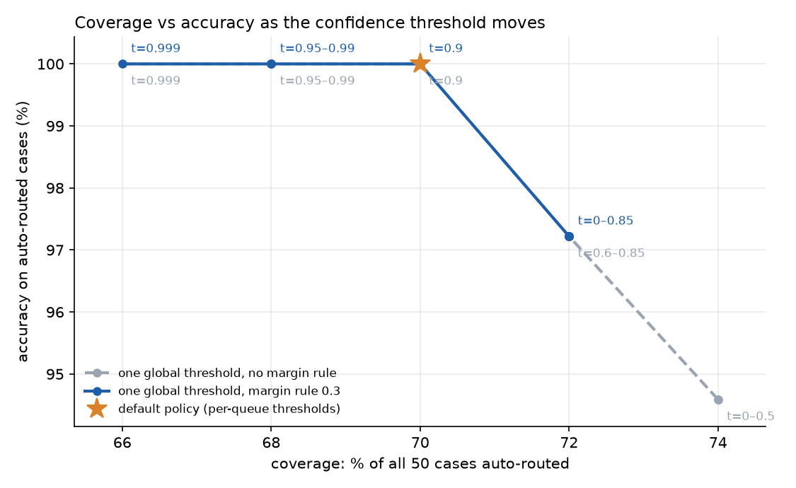

# Live run, 2026-11-09 (jev-1.14, 50 EXAMPLE cases)

Model `typesafe/jev-1.14` via OpenRouter (typesafe/jev-1.14-20261014). 50 EXAMPLE cases, default policy in `config/policy.json`.

## Headline

| metric | value |
|---|---|
| top-1 queue accuracy, all cases | 94% |
| auto-routed | 35 / 50 (70%) |
| accuracy on auto-routed | 100% (0 wrong) |
| sent to human review | 15 / 50 (30%) |
| expected-human cases caught | 100% |
| clear cases auto-routed | 100% |
| reviewer pre-fill (suggested queue) accuracy | 80% |
| latency p50 / p95 | 0.1517 s / 0.1957 s |
| total API cost | $0.001616 |

## Why cases went to human review

| reason | cases |
|---|---|
| `always_human` | 8 |
| `no_auto_route` | 4 |
| `escalation_risk` | 2 |
| `below_threshold` | 2 |
| `low_margin` | 1 |

## Confusion summary (expected -> predicted, mistakes only)

- `billing_refunds -> cancellations`: 1
- `returns_exchanges -> complaints_escalation`: 1
- `tech_login -> fraud_security`: 1

## Threshold sweep (one global threshold, hard rules kept)

| threshold | margin rule | auto-routed | coverage | accuracy on auto | wrong auto-routes |
|---|---|---|---|---|---|
| 0 | 0.3 | 36 | 72% | 97% | 1 |
| 0.5 | 0.3 | 36 | 72% | 97% | 1 |
| 0.6 | 0.3 | 36 | 72% | 97% | 1 |
| 0.7 | 0.3 | 36 | 72% | 97% | 1 |
| 0.8 | 0.3 | 36 | 72% | 97% | 1 |
| 0.85 | 0.3 | 36 | 72% | 97% | 1 |
| 0.9 | 0.3 | 35 | 70% | 100% | 0 |
| 0.95 | 0.3 | 34 | 68% | 100% | 0 |
| 0.98 | 0.3 | 34 | 68% | 100% | 0 |
| 0.99 | 0.3 | 34 | 68% | 100% | 0 |
| 0.999 | 0.3 | 33 | 66% | 100% | 0 |
| 0 | 0 | 37 | 74% | 95% | 2 |
| 0.5 | 0 | 37 | 74% | 95% | 2 |
| 0.6 | 0 | 36 | 72% | 97% | 1 |
| 0.7 | 0 | 36 | 72% | 97% | 1 |
| 0.8 | 0 | 36 | 72% | 97% | 1 |
| 0.85 | 0 | 36 | 72% | 97% | 1 |
| 0.9 | 0 | 35 | 70% | 100% | 0 |
| 0.95 | 0 | 34 | 68% | 100% | 0 |
| 0.98 | 0 | 34 | 68% | 100% | 0 |
| 0.99 | 0 | 34 | 68% | 100% | 0 |
| 0.999 | 0 | 33 | 66% | 100% | 0 |

## Every case

| case | expected | predicted | p | margin | esc. | route | reasons | note |
|---|---|---|---|---|---|---|---|---|
| case_01 | billing_refunds | billing_refunds | 1.00 | 1.00 | 0.02 | auto | - | Duplicate charge: clear billing case. |
| case_02 | billing_refunds | billing_refunds | 1.00 | 1.00 | 0.02 | auto | - | Refund timing after approval. |
| case_03 | billing_refunds | billing_refunds | 1.00 | 1.00 | 0.01 | auto | - | Promo not applied; money adjustment. |
| case_04 | billing_refunds | billing_refunds | 1.00 | 1.00 | 0.01 | auto | - | Invoice request; contains an email that must be redacted. |
| case_05 | billing_refunds | billing_refunds | 0.92 | 0.84 | 0.02 | auto | - | Unexplained recurring-looking charge; no subject. |
| case_06 | order_shipping | order_shipping | 1.00 | 1.00 | 0.01 | auto | - | Classic where-is-my-order. |
| case_07 | order_shipping | order_shipping | 1.00 | 1.00 | 0.01 | auto | - | Address change for an unshipped order. |
| case_08 | order_shipping | order_shipping | 1.00 | 1.00 | 0.02 | auto | - | Delivered-not-received: shipping queue (not fraud by default). |
| case_09 | order_shipping | order_shipping | 1.00 | 1.00 | 0.01 | auto | - | Shipping upgrade. |
| case_10 | order_shipping | order_shipping | 1.00 | 1.00 | 0.01 | auto | - | Partial delivery / split shipment. |
| case_11 | returns_exchanges | returns_exchanges | 1.00 | 1.00 | 0.01 | auto | - | Return label request. |
| case_12 | returns_exchanges | returns_exchanges | 1.00 | 1.00 | 0.01 | auto | - | Size exchange. |
| case_13 | returns_exchanges | returns_exchanges | 1.00 | 1.00 | 0.02 | auto | - | Return policy edge (past window). |
| case_14 | returns_exchanges | returns_exchanges | 1.00 | 1.00 | 0.01 | auto | - | Return processing status. |
| case_15 | tech_login | tech_login | 1.00 | 1.00 | 0.02 | auto | - | Login failure. |
| case_16 | tech_login | tech_login | 1.00 | 1.00 | 0.02 | auto | - | Reset email delivery; email redacted. |
| case_17 | tech_login | tech_login | 1.00 | 1.00 | 0.02 | auto | - | App bug. |
| case_18 | tech_login | tech_login | 1.00 | 1.00 | 0.01 | auto | - | 2FA SMS issue; phone redacted. |
| case_19 | tech_login | tech_login | 1.00 | 1.00 | 0.02 | auto | - | Checkout technical error. |
| case_20 | account_changes | account_changes | 1.00 | 1.00 | 0.01 | auto | - | Account email change; email redacted. |
| case_21 | account_changes | account_changes | 1.00 | 1.00 | 0.01 | auto | - | Profile update. |
| case_22 | account_changes | account_changes | 1.00 | 1.00 | 0.01 | auto | - | Account merge. |
| case_23 | account_changes | account_changes | 1.00 | 1.00 | 0.02 | auto | - | Communication preferences. |
| case_24 | fraud_security | fraud_security | 1.00 | 1.00 | 0.03 | human | always_human | Account takeover signal: always human. |
| case_25 | fraud_security | fraud_security | 1.00 | 1.00 | 0.01 | human | always_human | Phishing report; card number must be redacted; always human. |
| case_26 | fraud_security | fraud_security | 0.98 | 0.96 | 0.02 | human | always_human | Unauthorized change: fraud beats tech_login; always human. |
| case_27 | fraud_security | fraud_security | 1.00 | 1.00 | 0.02 | human | always_human | Scam victim; always human. |
| case_28 | product_questions | product_questions | 1.00 | 1.00 | 0.01 | auto | - | Pre-sale product question. |
| case_29 | product_questions | product_questions | 1.00 | 1.00 | 0.01 | auto | - | Compatibility. |
| case_30 | product_questions | product_questions | 1.00 | 1.00 | 0.01 | auto | - | Availability. |
| case_31 | product_questions | product_questions | 1.00 | 1.00 | 0.01 | auto | - | Care instructions. |
| case_32 | complaints_escalation | complaints_escalation | 1.00 | 1.00 | 0.02 | auto | - | Repeated-failure complaint asking for manager. |
| case_33 | complaints_escalation | complaints_escalation | 1.00 | 1.00 | 0.02 | auto | - | Service complaint. |
| case_34 | complaints_escalation | complaints_escalation | 0.99 | 0.98 | 0.03 | auto | - | Damaged twice: complaint. |
| case_35 | cancellations | cancellations | 1.00 | 1.00 | 0.01 | auto | - | Order cancellation. |
| case_36 | cancellations | cancellations | 1.00 | 1.00 | 0.01 | auto | - | Subscription cancellation. |
| case_37 | cancellations | cancellations | 1.00 | 1.00 | 0.01 | auto | - | Account closure request (cancellation, not privacy deletion). |
| case_38 | cancellations | cancellations | 1.00 | 1.00 | 0.01 | auto | - | Membership auto-renew. |
| case_39 | legal_privacy | legal_privacy | 1.00 | 1.00 | 0.13 | human | always_human | Data deletion request: always human. |
| case_40 | legal_privacy | legal_privacy | 1.00 | 1.00 | 0.06 | human | always_human | Data access request: always human. |
| case_41 | legal_privacy | legal_privacy | 0.93 | 0.86 | 0.98 | human | always_human, escalation_risk | Legal threat: billing topic but escalation flag forces human. |
| case_42 | billing_refunds | cancellations ✗ | 0.86 | 0.72 | 0.02 | human | below_threshold | Multi-intent: cancellation + refund. Either queue is defensible; low margin expected. |
| case_43 | returns_exchanges | complaints_escalation ✗ | 0.54 | 0.09 | 0.03 | human | below_threshold, low_margin | Multi-intent: shipping + complaint + return. |
| case_44 | other | other | 1.00 | 1.00 | 0.02 | human | no_auto_route | Greeting only, nothing actionable. |
| case_45 | other | other | 1.00 | 1.00 | 0.01 | human | no_auto_route | Off-topic business inquiry. |
| case_46 | other | other | 1.00 | 1.00 | 0.01 | human | no_auto_route | Completely off-topic. |
| case_47 | order_shipping | order_shipping | 1.00 | 1.00 | 0.02 | auto | - | Spanish where-is-my-order; tests multilingual routing. |
| case_48 | other | other | 0.99 | 0.98 | 0.01 | human | no_auto_route | Truncated message; should not be auto-routed. |
| case_49 | complaints_escalation | complaints_escalation | 0.95 | 0.91 | 0.98 | human | escalation_risk | Safety/injury: escalation flag forces human. |
| case_50 | tech_login | fraud_security ✗ | 1.00 | 1.00 | 0.02 | human | always_human | Ambiguous: tech glitch vs account takeover; should go to human. |
